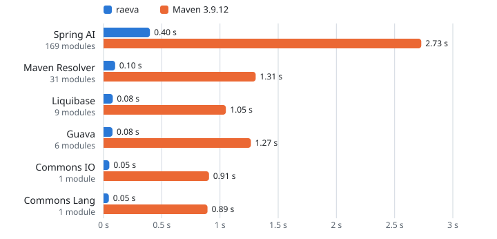

# Raeva

Maven has no lockfile. Version ranges, SNAPSHOTs, parent POMs and imported
BOMs let the same `pom.xml` resolve to different jars from one day to the
next, and nothing tells you when it happens.

Raeva resolves a Maven project by Maven 3.9's rules and writes `raeva.lock`:
every artifact, POM, parent and BOM, pinned by SHA-256. Commit it, and
`raeva sync --frozen` fails CI when a plain sync would change its pins.
Maven still runs the build and does not read the lock. For an offline build,
export the pins to an isolated Maven repository and prepare plugins separately
([Offline builds](docs/offline-builds.md)).

`raeva` is one native binary with no JVM. With a warm cache, it resolves a
project 7 to 19 times faster than Maven. A first sync from an empty local
repository also downloads every jar, which Maven's resolution skips, and is
still up to 6 times faster, or about as fast on a project with large jars.
Checking a lock that is up to date takes under a second.
On the open-source projects it is tested against, it resolves the same
dependencies as Maven 3.9.11, 3.9.16 and 3.10.0
([verification](docs/verification.md)).

<p align="center">
  <picture>
    <source media="(prefers-color-scheme: dark)" srcset="docs/assets/bench-warm-dark.svg">
    <source media="(prefers-color-scheme: light)" srcset="docs/assets/bench-warm-light.svg">
    
  </picture>
</p>

<p align="center">
  <i>Resolving with a warm cache, no lock: <code>raeva sync</code> against Maven 3.9.12 <code>dependency:tree</code> on six open-source projects. Medians of nine alternating runs on one Linux host.</i>
</p>

## Install

Linux and macOS:

```bash
curl -fsSL https://raeva.io/install.sh | sh
```

To check the archive's SHA-256 yourself, download it from the release
instead, as [Installation](docs/installation.md) describes.

Homebrew on Linux and macOS:

```bash
brew install raeva-io/tap/raeva
```

Windows, in PowerShell:

```powershell
irm https://raeva.io/install.ps1 | iex
```

[GitHub Releases](https://github.com/raeva-io/raeva/releases) has archives
for Linux and macOS (x86_64 and aarch64) and Windows (x86_64), and a Windows
`.msi` installer. Linux archives include glibc (`unknown-linux-gnu`) and
static musl (`unknown-linux-musl`) builds for both architectures. On Alpine,
use the musl archive. See [Installation](docs/installation.md).
With Rust 1.89 or newer, `cargo binstall raeva` installs
a prebuilt binary and `cargo install raeva` builds from source.

## Quick start

Run this at the project root, or at the root of a multi-module reactor, and
commit `raeva.lock`:

```bash
raeva sync        # resolve dependencies and write raeva.lock
```

Set `JAVA_HOME` to the JDK the build uses: without it or `JAVA_VERSION`,
raeva assumes Java 17. `raeva sync` locks the platform it runs on, so when
CI runs on another OS, lock both once, as in
`raeva sync --platforms linux-x86_64,macos-aarch64`; later syncs keep them.

Your Maven build stays as it is. In CI, add a step that runs
`raeva sync --frozen`: it downloads the locked artifacts and fails when a
plain `raeva sync` would change the lock, after an edit to a POM,
`.mvn/maven.config`, `.mvn/jvm.config` or the settings, or on another JDK
or environment. An
edit that resolves the same, such as a new comment, passes, and so does a
newer build of a locked SNAPSHOT. On
GitHub Actions, [setup-raeva](https://github.com/raeva-io/setup-raeva) installs
a pinned raeva and runs this check, with recipes for bot pull requests,
SNAPSHOT drift, and locked builds. For other CI systems, see
[Checking the lock in CI](docs/ci.md).

## Offline builds

For an offline build, use separate repositories for locked dependencies and
Maven's build plugins:

```bash
raeva export-m2 --m2-path "$PWD/.offline/deps"
mvn -Dmaven.repo.local="$PWD/.offline/plugins" -DskipTests package
mvn -o -Dmaven.repo.local="$PWD/.offline/deps" -Dmaven.repo.local.tail="$PWD/.offline/plugins" -DskipTests package
```

Run them at the project root and add `.offline/` to `.gitignore`; outside
`target/`, `mvn clean` keeps it. Use the same phase in both Maven runs, and
in both the profiles and settings `raeva sync` used. Plugins, plugin
dependencies, and build extensions are not locked. The online run resolves the dependencies too
and leaves them in the plugin repository, which the offline run reads as a
tail for what the export lacks. The export writes a version list under
every repository id it knows the build reads, empty where the lock takes
nothing from it, so a version range, SNAPSHOT, `RELEASE` or `LATEST`
resolves to what `raeva.lock` pins, not to a newer version in the tail.
See [Offline builds](docs/offline-builds.md#scope) and
[Verified against real projects](docs/verification.md) for the limits.

## Files

Dependencies come only from POMs. For each locked platform, `raeva.lock`
records one graph per active module and one list of external artifacts; a
reactor has one `raeva.lock` at its root. The optional `raeva.toml` holds
tool settings such as repositories and network limits, never dependencies
(see [Configuration](docs/configuration.md)). Mirrors and proxies belong to
the machine, in the user `config.toml` or `settings.xml`. `raeva` also reads
Maven's `~/.m2/settings.xml` for mirrors, proxies, server credentials, active
profiles and `<localRepository>`.

Downloaded files go to a content-addressed store that all your projects
share. A fresh resolution reuses artifact evidence only for the same declared
repository and serving endpoint (including mirrors), with a repository checksum
unless `--allow-missing-checksums` is set. Locked files are reused by digest.
Downloads without a lock pin or repository checksum require
`--allow-missing-checksums` or a local file repository.

## An `rv` alias

The command is `raeva`. Raeva does not install an `rv` command, since other
tools use that name. To type `rv` anyway, add `alias rv=raeva` to your shell
profile, or link it into a directory on your `PATH`:

```bash
ln -s "$(command -v raeva)" ~/.local/bin/rv
```

## Commands

| Command | Description |
| --- | --- |
| `raeva sync` | Resolve dependencies and write `raeva.lock` (`--frozen`, `--offline`, `--update`) |
| `raeva export-m2` | Export the locked artifacts to the Maven local repository |
| `raeva tree` | Show the dependency tree from `raeva.lock` |
| `raeva why <coord>` | Show the shortest paths that bring a dependency in (`--all` for up to 10,000 paths) |
| `raeva lock info`, `raeva lock verify`, `raeva lock diff` | Show lockfile statistics, check the locked artifacts in the store, or compare two locks |
| `raeva doctor` | Check that the store is writable and that the configured repositories, and those the project's POMs declare, can be reached with their credentials |
| `raeva vuln` | Scan the locked dependencies against OSV (`--vex` applies OpenVEX statements; `raeva vuln triage` records one) |
| `raeva sbom` | Write a CycloneDX SBOM (`--vex` adds the statements as analyses) |
| `raeva export-checksums` | Write `.mvn/checksums/checksums.sha256` (and `checksums.sha1` for SHA-1 pins) for Maven Trusted Checksums |

Every command accepts `-C <dir>` (`--project-root`), `-v`, `-q`, `--json`,
`--offline` (which `raeva doctor` and `raeva vuln` refuse, since they exist to
reach the network), and Maven's `-s <file>` (`--settings`), `-P <ids>`
(`--activate-profiles`) and `-D <name>=<value>` (`--define`), merged with
`.mvn/maven.config` as `mvn` merges them
([Maven options](docs/configuration.md#maven-options)). `raeva <command>
--help` lists every option.

## Exit codes

`raeva` exits 0 on success, 1 for a general error, 2 for a usage error, 3 for
configuration and credential errors, 4 for network errors, 5 when resolution
fails, 7 when `raeva.lock` is out of date, 9 when a download does not
match its published checksum, 130 on Ctrl-C, and 143 on SIGTERM. `raeva vuln` exits 1 when a finding meets
`--fail-on` (default `high`).
[JSON output](docs/json-output.md#exit-codes) lists every code; with `--json`,
a failed command also prints a stable error `code` and its suggestions as
`hints`.

## Documentation

- [Installation](docs/installation.md): binaries and supported platforms.
- [Is raeva for my project?](docs/project-fit.md): supported projects,
  current limits, and how to remove it.

- [Checking the lock in CI](docs/ci.md): a pinned install, platforms, JDKs,
  store caching, and `.gitattributes`, on any CI system.
- [Offline builds and the Maven reactor](docs/offline-builds.md): what is
  locked, frozen checks, and offline Maven builds.
- [Authentication](docs/authentication.md): `settings.xml` servers,
  `[[auth]]` entries, and credential precedence.
- [Configuration](docs/configuration.md): `raeva.toml`, environment variables,
  file locations, and checksum policy.
- [Vulnerability scans and SBOMs](docs/vulnerabilities-and-sboms.md):
  `raeva vuln` and `raeva sbom`.
- [JSON output, error codes, and warnings](docs/json-output.md): the `--json`
  envelope and every error and warning code.
- [Verified against real projects](docs/verification.md): parity with Maven
  on a corpus of 48 open-source projects.
- [Changelog](CHANGELOG.md)

## Raeva Cloud

Raeva Cloud is a hosted private Maven registry for `raeva`, Maven, and Gradle.
It is in private beta, with a waitlist at [raeva.io](https://raeva.io). `raeva`
needs no special support for it. It does not proxy Maven Central, so add it as
a repository next to Central, not as a mirror of `central` or `*`, and give
its read token to a `settings.xml` `<server>` with the repository's id
([Authentication](docs/authentication.md)). On GitHub Actions, start from
setup-raeva's
[`examples/private.yml`](https://github.com/raeva-io/setup-raeva/blob/main/examples/private.yml).

## License

MIT OR Apache-2.0
