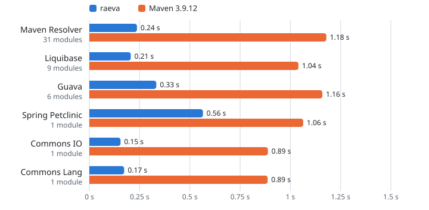

# Raeva

Maven has no lockfile. Version ranges, SNAPSHOTs, parent POMs and imported
BOMs let the same `pom.xml` resolve to different jars from one day to the
next, and nothing tells you when it happens.

Raeva resolves a Maven project by Maven 3.9's rules, or 3.10's when the
project selects them, and writes `raeva.lock`:
every artifact, POM, parent and BOM, pinned by SHA-256. Commit it, and
`raeva sync --frozen` resolves again and fails CI when the lock does not match.
Maven still runs the build and does not read the lock. For an offline build,
export the pins to an isolated Maven repository. `[plugins] lock = true` in
`raeva.toml` locks the build's plugins and extensions as well
([Offline builds](docs/offline-builds.md)).

`raeva` is one native binary with no JVM. With a warm cache, it resolves a
project 3 to 6 times faster than Maven, and about twice as fast on a Spring
Boot project that uses GraalVM's native-maven-plugin, a build extension
whose dependencies raeva also resolves. A first sync from an empty local
repository also downloads every jar, which Maven's resolution skips, and was
still 2 to 9 times faster in our runs. Checking a lock with a warm store
resolves the project again, in about 0.4 s on Guava and under 3 s on Trino's 111 modules.
On the open-source projects it is tested against, it resolves the same
dependencies as Maven 3.10.0
([verification](docs/verification.md)).

<p align="center">
  <picture>
    <source media="(prefers-color-scheme: dark)" srcset="docs/assets/bench-warm-dark.svg">
    <source media="(prefers-color-scheme: light)" srcset="docs/assets/bench-warm-light.svg">
    
  </picture>
</p>

<p align="center">
  <i>Resolving with a warm cache, no lock: <code>raeva sync</code> against Maven 3.9.12 <code>dependency:tree</code> on six open-source projects. Medians of nine alternating runs on one Linux host.</i>
</p>

## Install

Linux and macOS:

```bash
curl -fsSL https://raeva.io/install.sh | sh
```

To check the archive's SHA-256 yourself, download it from the release
instead, as [Installation](docs/installation.md) describes.

Homebrew on Linux and macOS:

```bash
brew install raeva-io/tap/raeva
```

Windows, in PowerShell:

```powershell
powershell -ExecutionPolicy ByPass -c "irm https://raeva.io/install.ps1 | iex"
```

[GitHub Releases](https://github.com/raeva-io/raeva/releases) has archives
for Linux and macOS (x86_64 and aarch64) and Windows (x86_64), and a Windows
`.msi` installer. Linux archives include glibc (`unknown-linux-gnu`) and
static musl (`unknown-linux-musl`) builds for both architectures. On Alpine,
use the musl archive. See [Installation](docs/installation.md).
With Rust 1.89 or newer, `cargo binstall raeva` installs
a prebuilt binary and `cargo install --locked raeva` builds from source.

## Quick start

raeva reads the JDK version as `mvn` finds the JDK: from `JAVA_HOME`, else
from the `java` on `PATH`. Then run this at the project root, or at the root of
a multi-module reactor, and commit `raeva.lock`:

```bash
raeva sync        # resolve dependencies and write raeva.lock
raeva doctor      # platforms, JDK, CI check, plugins
```

If CI builds on several JDKs, list them in `[lock] jdks` before the first
sync ([Name the JDK](docs/ci.md#name-the-jdk)). With a version manager's
`java` shim, such as asdf's or jenv's, set `JAVA_HOME`.

`raeva sync` locks the platform it runs on, so when
CI runs on another OS, lock both once, as in
`raeva sync --platforms linux-x86_64,macos-aarch64`; later syncs keep them.

Your Maven build stays as it is. In CI, add a step that runs
`raeva sync --frozen`. It resolves again, downloads the locked artifacts,
and fails when the result differs from the lock: after an edit to a POM,
`.mvn/maven.config`, `.mvn/jvm.config`, the settings or the lock alone, or
on another JDK or environment. An edit that resolves the same, such as a
new comment, passes. A newer upstream build of a locked SNAPSHOT also
passes: `--frozen` keeps the locked build, and `raeva sync --update` moves
it. If the repository replaced or removed a file the lock pins, the check
fails when it must download that file. A change to the repositories or
other configuration the lock records fails even when it resolves the same. On
GitHub Actions, [setup-raeva](https://github.com/raeva-io/setup-raeva) installs
a pinned raeva and, with `check: true`, runs this check, with recipes for bot pull requests,
SNAPSHOT drift, and locked builds. For other CI systems, see
[Checking the lock in CI](docs/ci.md).

## Offline builds

Plugin locking is opt-in. With `[plugins] lock = true` in `raeva.toml`,
`raeva sync` also locks the build plugins, their dependencies and build
extensions, and `[plugins] trace` pins what they download while they run.
One export then holds everything the offline build reads:

```toml
# raeva.toml
[plugins]
lock = true
trace = ["verify"]
```

`trace` runs that Maven build in this checkout when an online plain
`raeva sync` finds no trace of it for this OS and architecture. The build
can take minutes and leaves its output, such as `target/`, behind.
`--frozen` never runs it. A build that checks license headers, such as
Apache RAT, needs one in `raeva.toml`. With the Maven wrapper, set
`mvn = "./mvnw"`. After changing what a traced plugin downloads, such as a
formatter version, run `raeva sync --update`. The trace serves the OS and
architecture that ran it: run an online `raeva sync` on each one where CI
runs `--frozen`
([Lock every platform](docs/ci.md#lock-every-platform-ci-runs-on)).

```bash
raeva sync
offline="$(mktemp -d "${TMPDIR:-/tmp}/raeva-offline.XXXXXX")"
raeva export-m2 --m2-path "$offline/m2"
mvn -o "-Dmaven.repo.local=$offline/m2" verify
```

Without `[plugins] lock = true`, the lock pins dependencies, and the build
extension jars of a module whose dependencies have a type Maven's core
does not define. Use separate
repositories for the locked dependencies and Maven's build plugins, filled
by one online Maven run:

```bash
offline="$(mktemp -d "${TMPDIR:-/tmp}/raeva-offline.XXXXXX")"
raeva export-m2 --m2-path "$offline/deps"
mvn "-Dmaven.repo.local=$offline/plugins" -DskipTests package
mvn -o "-Dmaven.repo.local=$offline/deps" "-Dmaven.repo.local.tail=$offline/plugins" -DskipTests package
```

In PowerShell, see [Offline builds](docs/offline-builds.md#scope). Run them
at the project root. Keep the repositories out of the checkout:
build checks such as Apache RAT and Spring's nohttp scan every file in it,
and `mvn clean` deletes `target/`. Use the same phase in both Maven runs,
and in both the profiles and settings `raeva sync` used. The online run
resolves the dependencies too and leaves them in the plugin repository,
which the offline run reads as a tail for what the export lacks. The export
writes a version list under every repository id it knows the build reads,
empty where the lock takes nothing from it. A version range, SNAPSHOT,
`RELEASE` or `LATEST` then resolves to what `raeva.lock` pins, not to a
newer version in the tail. The export refuses (exit 3) to write the list
of a locked artifact that the build also loads as a plugin or extension
without a version, unless the lock records a `<release>` for it, which
plugin locking does. See [Locked plugins](docs/offline-builds.md#locked-plugins),
[Offline builds](docs/offline-builds.md#scope) and
[Verified against real projects](docs/verification.md) for the limits.

## Files

Dependencies come only from POMs. For each locked platform, `raeva.lock`
records one graph per active module and one list of external artifacts; a
reactor has one `raeva.lock` at its root. The optional `raeva.toml` holds
tool settings such as repositories and network limits, never dependencies
(see [Configuration](docs/configuration.md)). Mirrors and proxies belong to
the machine, in the user `config.toml` or `settings.xml`. `raeva` also reads
Maven's `~/.m2/settings.xml` for mirrors, proxies, server credentials, active
profiles, plugin groups and `<localRepository>`.

Downloaded files go to a content-addressed store that all your projects
share. A fresh resolution reuses artifact evidence only for the same declared
repository and serving endpoint (including mirrors), with a repository checksum
unless `--allow-missing-checksums` is set. Locked files are reused by digest.
Downloads without a lock pin or repository checksum require
`--allow-missing-checksums` or a local file repository.

## An `rv` alias

The command is `raeva`. Raeva does not install an `rv` command, since other
tools use that name. To type `rv` anyway, add `alias rv=raeva` to your shell
profile, or link it into a directory on your `PATH`:

```bash
ln -s "$(command -v raeva)" ~/.local/bin/rv
```

## Commands

| Command | Description |
| --- | --- |
| `raeva sync` | Resolve dependencies and write `raeva.lock` (`--frozen`, `--offline`, `--update`) |
| `raeva export-m2` | Export the locked artifacts to the Maven local repository |
| `raeva tree` | Show the dependency tree from `raeva.lock` |
| `raeva why <coord>` | Show the shortest paths that bring a dependency in (`--all` for up to 10,000 paths) |
| `raeva lock info`, `raeva lock verify`, `raeva lock diff` | Show lockfile statistics, check the locked artifacts in the store, or compare two locks |
| `raeva doctor` | Check how the project fits raeva (Maven mode, extensions, Polyglot, plugin locking, lock platforms, the CI check, `.gitattributes`), that the store is writable, and that the configured repositories, those the project's POMs declare, and with plugin locking the plugin repositories of the POMs and of settings.xml, can be reached with their credentials |
| `raeva vuln` | Scan the locked dependencies against OSV (`--vex` applies OpenVEX statements; `raeva vuln triage` records one) |
| `raeva sbom` | Write a CycloneDX SBOM (`--vex` adds the statements as analyses) |
| `raeva export-checksums` | Write `.mvn/checksums/checksums.sha256` (and `checksums.sha1` for SHA-1 pins) for Maven Trusted Checksums |
| `raeva seed key`, `raeva seed save <dir>`, `raeva seed restore <dir>` | Carry the locked files between CI jobs in a cache, checked against their pins when restored ([CI](docs/ci.md#seed-the-store-and-the-maven-repository)) |

Every command accepts `-C <dir>` (`--project-root`), `-v`, `-q`, `--json`,
`--offline`, and Maven's `-s <file>` (`--settings`), `-P <ids>`
(`--activate-profiles`) and `-D <name>=<value>` (`--define`), merged with
`.mvn/maven.config` as `mvn` merges them
([Maven options](docs/configuration.md#maven-options)). `raeva vuln`
refuses `--offline`, since it exists to reach the network. Under
`--offline`, `raeva doctor` checks the project and the store and probes no
repository. `raeva <command> --help` lists every option.

## Exit codes

`raeva` exits 0 on success, 1 for a general error, 2 for a usage error, 3 for
configuration and credential errors, 4 for network errors, 5 when resolution
fails, 6 when `raeva` could not start, 7 when `raeva.lock` is out of date, 8
when some `raeva doctor` checks pass and others fail, 9 when a download does
not match its published checksum, 130 on Ctrl-C, and 143 on SIGTERM. `raeva vuln` exits 1 when a finding meets
`--fail-on` (default `high`).
[JSON output](docs/json-output.md#exit-codes) lists every code; with `--json`,
a failed command also prints a stable error `code` and its suggestions as
`hints`.

## Documentation

- [Installation](docs/installation.md): binaries and supported platforms.
- [Is raeva for my project?](docs/project-fit.md): supported projects,
  current limits, and how to remove it.

- [Checking the lock in CI](docs/ci.md): a pinned install, platforms, JDKs,
  store caching, and `.gitattributes`, on any CI system.
- [Offline builds and the Maven reactor](docs/offline-builds.md): what is
  locked, frozen checks, and offline Maven builds.
- [Authentication](docs/authentication.md): `settings.xml` servers,
  `[[auth]]` entries, and credential precedence.
- [Configuration](docs/configuration.md): `raeva.toml`, environment variables,
  file locations, and checksum policy.
- [Vulnerability scans and SBOMs](docs/vulnerabilities-and-sboms.md):
  `raeva vuln` and `raeva sbom`.
- [JSON output, error codes, and warnings](docs/json-output.md): the `--json`
  envelope and every error and warning code.
- [Verified against real projects](docs/verification.md): parity with Maven
  on a corpus of 48 open-source projects.
- [Changelog](CHANGELOG.md)

## Raeva Cloud

Raeva Cloud is a hosted private Maven registry for `raeva`, Maven, and Gradle.
It is in private beta, with a waitlist at [raeva.io](https://raeva.io). `raeva`
needs no special support for it. It does not proxy Maven Central, so add it as
a repository next to Central, not as a mirror of `central` or `*`, and give
its read token to a `settings.xml` `<server>` with the repository's id
([Authentication](docs/authentication.md)). The registry ignores the
username, but `raeva` refuses an empty one, so use the literal `token`:

```xml
<server>
  <id>raeva</id>
  <username>token</username>
  <password>${env.RAEVA_TOKEN}</password>
</server>
```

`raeva doctor` shows the registry as `inconclusive`, since doctor asks for
Maven Central metadata the registry does not hold. Confirm the token with
`raeva sync`, in a fresh `RAEVA_HOME`, on a project that depends on a file
you published there: a sync with a warm store may not ask the registry. On
GitHub Actions, start from
setup-raeva's
[`examples/private.yml`](https://github.com/raeva-io/setup-raeva/blob/main/examples/private.yml).

## License

MIT OR Apache-2.0
